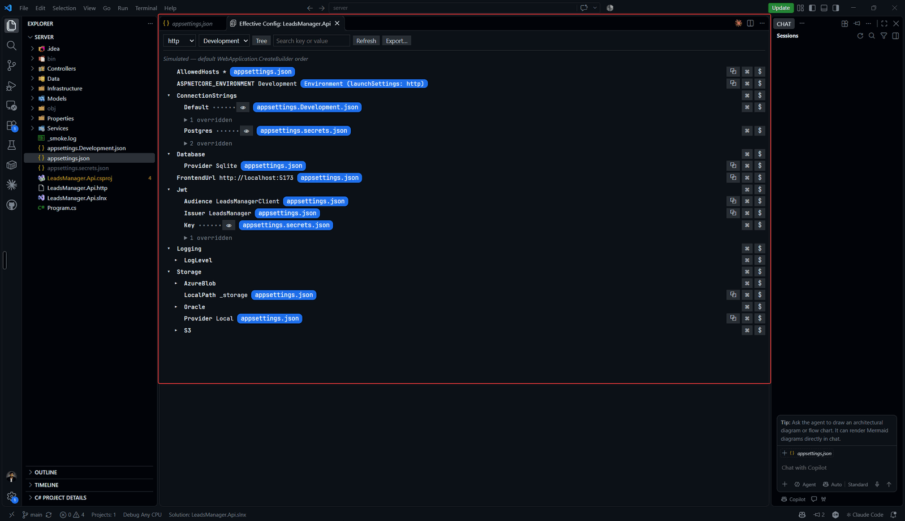
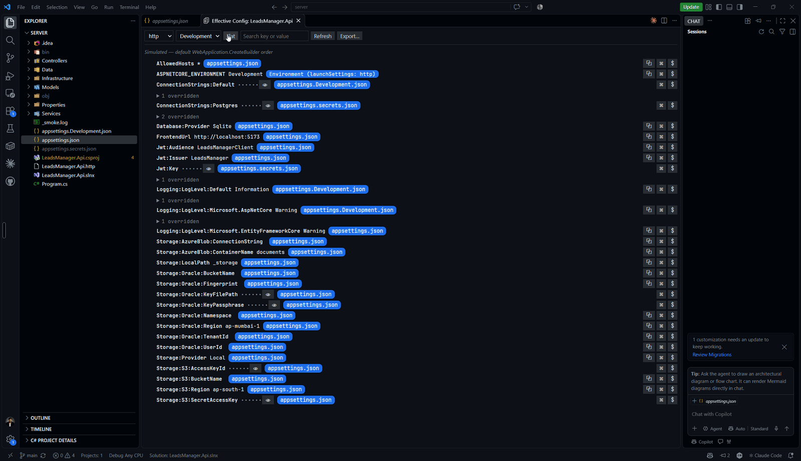

# Effective Config Viewer

**See the exact configuration your .NET or Python app will load — every value, and where it came from.**

Config is spread across layers: `appsettings.json`, environment overrides, user secrets, `.env` files, OS variables, launch profiles. Effective Config Viewer merges them the way your framework does and shows you the final result in one panel — with the winning source of every value and the chain of what it overrode.

Nothing is built or run. The merge is reproduced in the extension, so you see the result without starting your app.

*Tree view — merged configuration with the winning source for every value:*

*Flat view — every key as `Section:Key`, searchable:*

## Features

- **Merged view, one panel.** The final config for a chosen environment, as a tree or a flat `Section:Key = value` list. Search by key or value.
- **Provenance for every value.** See which layer won and the full override chain. Click a source to jump to the exact line that set it.
- **.NET and Python, side by side.** .NET projects (`.csproj` + `appsettings.json`) and Python projects (`.env` + a project marker) share one switcher, tagged `[.NET]` / `[Python]`.
- **Faithful merge order.** .NET: the default `WebApplication.CreateBuilder` order (JSON layers → user secrets → env vars → command-line args). Python: python-dotenv order, OS-wins by default, flip with one setting.
- **Launch profiles.** Reads `launchSettings.json` (.NET) and `.vscode/launch.json` (Python); the profile preselects the environment.
- **Secrets stay hidden.** Values from secret layers or matching a mask pattern are masked and never sent to the webview until you reveal them one at a time. Values expanded from a secret stay masked too.
- **Copy & export.** Copy a value, key path, or env-var name. Export the merged result as nested JSON or flat `KEY=value`.
- **Auto-refresh.** The panel updates when any source file changes, keeping your expanded and revealed state.

## Open the panel

- Command Palette → **Effective Config: Show Merged Configuration**
- Right-click an `appsettings*.json`, `.csproj`, `.env` or `.env.*` file in the Explorer
- The editor-title button while an `appsettings*.json` or `.env*` file is open

Pick the project, launch profile and environment at the top of the panel.

## How the merge works

### .NET (lowest priority first)
1. `appsettings.json`
2. `appsettings.{Env}.json`
3. `appsettings.secrets.json` *(when present)*
4. User Secrets *(Development only, via `UserSecretsId`)*
5. Environment variables *(OS, filtered, then the launch profile's)*
6. Command-line args *(profile `commandLineArgs`)*

### Python (lowest priority first; OS wins by default)
1. `.env`
2. `.env.{env}`
3. `.env.local`
4. `.env.{env}.local`
5. OS environment variables *(filtered)*
6. Launch profile `envFile`, then `env`

Set `effectiveConfig.python.fileOverridesOs` to move the files above OS variables (python-dotenv `override=True`). `.env` parsing follows python-dotenv rules, including `${VAR}` / `${VAR:-default}` expansion.

## Settings

| Setting | Default | Description |
| --- | --- | --- |
| `effectiveConfig.dotnet.jsonLayers` | `["appsettings.json", "appsettings.{env}.json", "appsettings.secrets.json"]` | JSON layers, lowest first. `{env}` = selected environment. A pattern containing `secret` is treated as sensitive. |
| `effectiveConfig.maskPatterns` | `["*Password*", "*Secret*", "*Key*", "*TOKEN*", "ConnectionStrings:*"]` | Case-insensitive globs of keys whose values are masked by default. |
| `effectiveConfig.python.envFiles` | `[".env", ".env.{env}", ".env.local", ".env.{env}.local"]` | Python env files, lowest first. A pattern containing `secret` is treated as sensitive. |
| `effectiveConfig.python.fileOverridesOs` | `false` | When true, env files override OS variables. |
| `effectiveConfig.python.envPrefixes` | `[]` | OS variables with these prefixes are shown even when no file defines them. |
| `effectiveConfig.python.nestedDelimiter` | `"__"` | Splits keys into the tree; empty string for flat keys. |
| `effectiveConfig.python.environmentVariables` | `["APP_ENV", "ENV", "ENVIRONMENT", "PYTHON_ENV"]` | Variables, in order, that name the active environment. |

## Known limitations

**.NET:** custom providers, Azure Key Vault / App Configuration, `Program.cs` reordering, `Directory.Build.props` `UserSecretsId`, legacy `SQLCONNSTR_` prefixes and switch mappings are not reflected.

**Python:** `.flaskenv`, Django settings modules, `os.environ` reads in code, conda `environment.yml`, direnv, Poetry/pipenv auto-loading and pydantic `secrets_dir` are not reflected. Some rare quote escapes are not decoded.

## Adding a language provider

1. Create a folder `src/<language>/` with a `ConfigProvider`. For dotenv-style languages, extend `DotenvProviderBase` (`src/sources/dotenvProviderBase.ts`) and implement `describe`; it provides environment detection, and `src/sources/dotenvEnvironments.ts` lists environments and watch globs. Override `readProcessEnvironment` if something other than the OS sets process variables.
2. Export an `Ecosystem` from that folder (`src/<language>/ecosystem.ts`): its kind, picker tag, discovery and provider factory.
3. Add it to `ECOSYSTEMS` in `src/hostEcosystems.ts`, before Python: Python's fallback project gives way to projects the earlier ecosystems found.

Everything else stays in the folder: layers may use their own `kind`, and settings are read with `settingsSource()` from `src/hostServices.ts`. The one exception is the VS Code manifest: new settings and Explorer or editor-title triggers for other file names must be declared in `package.json`.

## License

MIT
