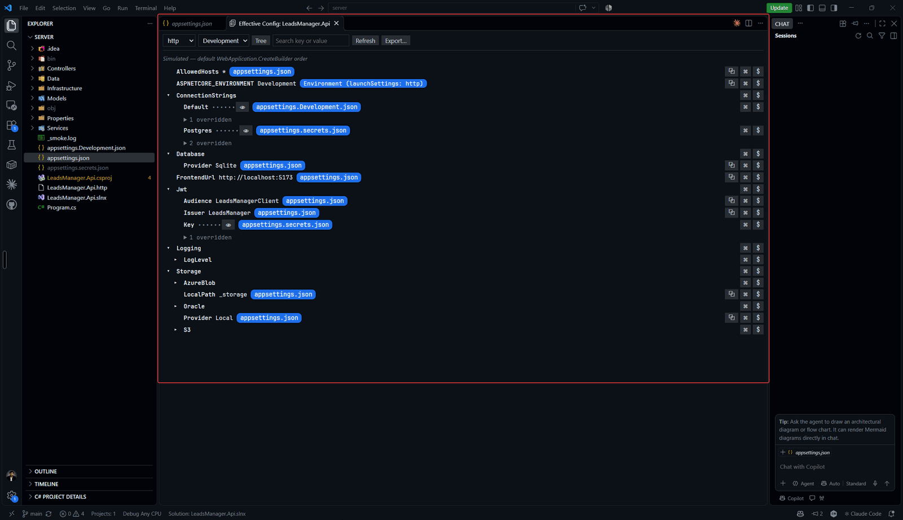
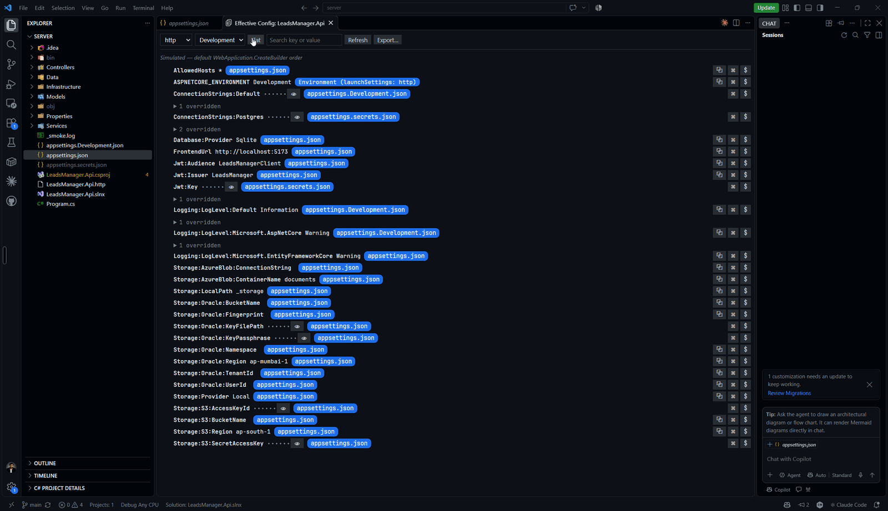

# Effective Config Viewer

**See the exact configuration your .NET, Python or Node app, or Docker Compose service, will load — every value, and where it came from.**

Config is spread across layers: `appsettings.json`, environment overrides, user secrets, `.env` files, OS variables, launch profiles. Effective Config Viewer merges them the way your framework does and shows you the final result in one panel — with the winning source of every value and the chain of what it overrode.

Nothing is built or run. The merge is reproduced in the extension, so you see the result without starting your app.

*Tree view — merged configuration with the winning source for every value:*

*Flat view — every key as `Section:Key`, searchable:*

## Features

- **Merged view, one panel.** The final config for a chosen environment, as a tree or a flat `Section:Key = value` list. Search by key or value.
- **Provenance for every value.** See which layer won and the full override chain. Click a source to jump to the exact line that set it.
- **.NET, Python, Node and Docker Compose, side by side.** .NET projects (`.csproj` + `appsettings.json`), Python projects (`.env` + a project marker), Node projects (`package.json` + `.env`) and Compose projects (`compose.yaml` or `docker-compose.yml`) share one switcher, tagged `[.NET]` / `[Python]` / `[Node]` / `[Compose]`.
- **Faithful merge order.** .NET: the default `WebApplication.CreateBuilder` order (JSON layers → user secrets → env vars → command-line args). Python: python-dotenv order, OS-wins by default, flip with one setting. Node: the order of the framework found in `package.json` (Vite, Next.js, Create React App, dotenv-flow). Compose: `env_file` → `environment`, base file → override file, with Compose interpolation.
- **Launch profiles.** Reads `launchSettings.json` (.NET) and `.vscode/launch.json` (Python); the profile preselects the environment.
- **Secrets stay hidden.** Values from secret layers or matching a mask pattern are masked and never sent to the webview until you reveal them one at a time. Values expanded from a secret stay masked too.
- **Copy & export.** Copy a value, key path, or env-var name. Export the merged result as nested JSON or flat `KEY=value`.
- **Auto-refresh.** The panel updates when any source file changes, keeping your expanded and revealed state.

## Open the panel

- Command Palette → **Effective Config: Show Merged Configuration**
- Right-click an `appsettings*.json`, `.csproj`, `.env`, `.env.*` or compose file (`compose.yaml`, `docker-compose.yml`, their `.yml`/`.yaml` variants and override files) in the Explorer
- The editor-title button while an `appsettings*.json`, `.env*` or compose file is open

Pick the project, launch profile and environment at the top of the panel. For a Compose project, the profile picker chooses the service and the environment picker chooses the env file.

## How the merge works

### .NET (lowest priority first)
1. `appsettings.json`
2. `appsettings.{Env}.json`
3. `appsettings.secrets.json` *(when present)*
4. User Secrets *(Development only, via `UserSecretsId`)*
5. Environment variables *(OS, filtered, then the launch profile's)*
6. Command-line args *(profile `commandLineArgs`)*

### Python (lowest priority first; OS wins by default)
1. `.env`
2. `.env.{env}`
3. `.env.local`
4. `.env.{env}.local`
5. OS environment variables *(filtered)*
6. Launch profile `envFile`, then `env`

Set `effectiveConfig.python.fileOverridesOs` to move the files above OS variables (python-dotenv `override=True`). `.env` parsing follows python-dotenv rules, including `${VAR}` / `${VAR:-default}` expansion.

### Node (lowest priority first; OS variables always win)
The framework is detected from the `package.json` dependencies (first match: `next`, `react-scripts`, `vite`, `dotenv-flow`) or forced with `effectiveConfig.node.framework`.

| Framework | Files | Mode from | `.env.local` under `test` | OS variables shown even when no file defines them |
| --- | --- | --- | --- | --- |
| Vite | `.env`, `.env.local`, `.env.{mode}`, `.env.{mode}.local` | `MODE`, then `NODE_ENV` | loaded | `VITE_*` |
| Next.js | `.env`, `.env.{mode}`, `.env.local`, `.env.{mode}.local` | `NODE_ENV` (`development`, `production`, `test`) | skipped | `NEXT_PUBLIC_*` |
| Create React App | same as Next.js | `NODE_ENV` (`development`, `production`, `test`) | skipped | `REACT_APP_*` |
| dotenv-flow | same as Vite | `NODE_ENV` | skipped | none |
| Generic (no known framework) | same as Next.js | `NODE_ENV` | loaded | none |

The mode is read from the OS, then `.env`; `development` when neither names one. Keys stay flat (no `__` nesting).

### Docker Compose (lowest priority first)
The panel shows the environment the selected service's container would receive, without running Docker.

1. Each `env_file` of the service, in order. The string, list and `{ path, required }` forms are read, with paths relative to the compose file that declares them. Lists from override files are appended to the base file's list.
2. The service's `environment` in each compose file, base file first, then the override file. Map and list (`NAME=value`) forms are read. An override that sets one variable keeps the base file's others, and shows the base value in the override chain.

Values are interpolated the way Compose does it. The OS environment wins over the selected env file, and an env file line may use the OS or its own earlier lines.

- **Interpolation forms:** `$VAR`, `${VAR}`, `${VAR:-default}`, `${VAR-default}`, `${VAR:?error}`, `${VAR?error}`, `${VAR:+replacement}`, `${VAR+replacement}`, nested expressions in defaults, and `$$` for a literal `$`. Values in `env_file` files are interpolated too, except single-quoted ones.
- **Missing values:** an unset variable without a default becomes an empty string, with a warning. A missing `:?` / `?` variable anywhere in a loaded compose file is an error diagnostic at its line, even in another service. It shows the author's message, and the key stays visible with an empty value.
- **Value-less variables:** `FOO:` and `- FOO` take the value from the OS or the env file. When neither sets it, the variable is left out and an info says so.
- **Merge tags:** `!reset` and `!override` on a service's `environment` or `env_file` drop what lower files set. `FOO: !reset null` removes one variable.
- **Env file dropdown:** simulates `docker compose --env-file`. It lists `.env`, then the other `.env.*` and `*.env` files in the project folder. `.env` is preselected, unless `COMPOSE_ENV_FILES` in the OS names another listed file first.
- **Compose files:** `effectiveConfig.compose.files` when set (like `-f`), else `COMPOSE_FILE` from the OS or the env file (split on `COMPOSE_PATH_SEPARATOR`; `;` on Windows, `:` elsewhere), else the first of `compose.yaml`, `compose.yml`, `docker-compose.yaml`, `docker-compose.yml` with its override file (`compose.override.*` or `docker-compose.override.*`).
- **Profiles:** a service gated by `profiles` stays in the picker. When none of its profiles is in `COMPOSE_PROFILES`, an info names the profiles it needs.

Variable names are matched case-insensitively, as for Python and Node, so `PATH` and `Path` merge as one key.

## Settings

| Setting | Default | Description |
| --- | --- | --- |
| `effectiveConfig.compose.files` | `[]` | Compose files to load, lowest first, like `docker compose -f`, relative to the project folder. A listed file that does not exist is an error. Empty uses `COMPOSE_FILE` or the default compose file and its override. Can be set per folder. |
| `effectiveConfig.dotnet.jsonLayers` | `["appsettings.json", "appsettings.{env}.json", "appsettings.secrets.json"]` | JSON layers, lowest first. `{env}` = selected environment. A pattern containing `secret` is treated as sensitive. |
| `effectiveConfig.maskPatterns` | `["*Password*", "*Secret*", "*Key*", "*TOKEN*", "ConnectionStrings:*"]` | Case-insensitive globs of keys whose values are masked by default. |
| `effectiveConfig.node.framework` | `"auto"` | Node framework whose `.env` order is simulated: `auto` (detect from `package.json`), `vite`, `next`, `cra`, `dotenv-flow` or `generic`. |
| `effectiveConfig.python.envFiles` | `[".env", ".env.{env}", ".env.local", ".env.{env}.local"]` | Python env files, lowest first. A pattern containing `secret` is treated as sensitive. |
| `effectiveConfig.python.fileOverridesOs` | `false` | When true, env files override OS variables. |
| `effectiveConfig.python.envPrefixes` | `[]` | OS variables with these prefixes are shown even when no file defines them. |
| `effectiveConfig.python.nestedDelimiter` | `"__"` | Splits keys into the tree; empty string for flat keys. |
| `effectiveConfig.python.environmentVariables` | `["APP_ENV", "ENV", "ENVIRONMENT", "PYTHON_ENV"]` | Variables, in order, that name the active environment. |

## Known limitations

**.NET:** custom providers, Azure Key Vault / App Configuration, `Program.cs` reordering, `Directory.Build.props` `UserSecretsId`, legacy `SQLCONNSTR_` prefixes and switch mappings are not reflected.

**Python:** `.flaskenv`, Django settings modules, `os.environ` reads in code, conda `environment.yml`, direnv, Poetry/pipenv auto-loading and pydantic `secrets_dir` are not reflected. Some rare quote escapes are not decoded.

**Node:** `envDir` / `envPrefix` in `vite.config`, `--mode` flags in npm scripts, `env` in `next.config`, env files outside the package folder (monorepos) and `process.env` assignments in code are not reflected. Expansion follows the python-dotenv rules for every preset: `$VAR` without braces stays literal, and dotenv-flow values are expanded although dotenv-flow itself does not expand them.

**Docker Compose:** `extends`, top-level `include` (an info says so), Dockerfile `ENV`, `docker compose run -e`, `secrets` / `configs`, `-p` and `env_file` `format: raw` are not simulated. Only the first file in `COMPOSE_ENV_FILES` is used, and env files resolve from the project folder rather than the working directory. A bare `KEY` line in an `env_file` file is skipped, although Compose takes its value from the shell. `!reset` and `!override` on other fields are accepted and ignored.

## Adding a language provider

1. Create a folder `src/<language>/` with a `ConfigProvider`. For dotenv-style languages, extend `DotenvProviderBase` (`src/sources/dotenvProviderBase.ts`) and implement `describe`; it provides environment detection, and `src/sources/dotenvEnvironments.ts` lists environments and watch globs. Override `readProcessEnvironment` if something other than the OS sets process variables.
2. Export an `Ecosystem` from that folder (`src/<language>/ecosystem.ts`): its kind, picker tag, discovery and provider factory.
3. Add it to `ECOSYSTEMS` in `src/hostEcosystems.ts`, before Python: Python's fallback project gives way to projects the earlier ecosystems found.

Everything else stays in the folder: layers may use their own `kind`, and settings are read with `settingsSource()` from `src/hostServices.ts`. The one exception is the VS Code manifest: new settings and Explorer or editor-title triggers for other file names must be declared in `package.json`.

## License

MIT
